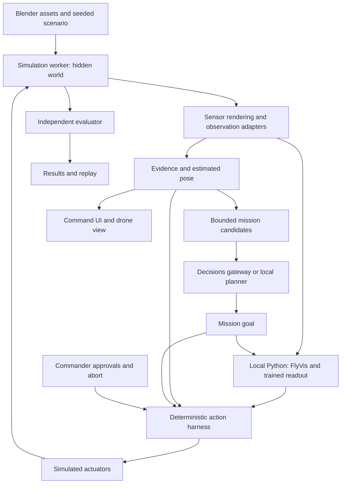

# FlyFireFighter architecture

November 7, 2026 · Build specification · [PRD](PRD.md) · [Demo loop](DemoLoop.md)

**One continuous rescue mission: approach a Troy building, enter, find a possible occupant, request bounded suppression, reassess the exit and guide the simulated occupant outside.** The fly model supplies motion responses; the mission planner selects goals; the harness checks execution and obtains individual commander approvals.

Current implementation (November 7, 2026): the contracts, harness, evidence store, simulator, evaluator, route assessor, planner and Decisions gateway, optical-flow and engineered readout controllers, the pinned FlyVis runtime and WebSocket service, the Blender Troy scene and the mission workspace are committed and tested. The integrated mission runtime/worker, the trained readout and its held-out comparison, and paired evaluation are in progress; see [PLAN.md](PLAN.md). No controller-improvement or rescue-rate results have been measured yet.

## 1. Decisions

| Area | Decision |
| --- | --- |
| Experience | Realistic exterior and drone camera; continuous interior flight; command can switch to a labeled cutaway. |
| Location | Initial exterior reference: Peoples Avenue and Heffner Alumni House near RPI. Author the interior and incident separately. This is not the 13th Street fire reconstruction. |
| Scene production | Blender authors geometry, materials, rigged scanned people and animation. Export bounded GLB assets and separate simulation metadata. |
| Motion | Pretrained FlyVis visual network, initially frozen; train a small motion readout and compare it with conventional optical flow. |
| Mission intelligence | OpenAI Decisions chooses among application-generated candidates. A deterministic planner runs locally when cloud decisions are unavailable. |
| Authority | Every glass-breaking, water discharge and payload release needs its own commander approval. AI output never grants that approval. |
| Rescue | Suppression changes the world; fresh observations precede guidance; exterior arrival is independently scored. Finding a person is an intermediate result. |
| Deployment | One local browser, one local Python neural service and one Next server. No database, distributed agent framework or aircraft SDK is required for the first mission. |

## 2. Runtime and ownership



The **Web Worker owns the simulation clock, world transitions, evidence store, harness and event log**. These are separate modules with explicit inputs, even though they initially share a process. React sends commands and renders snapshots; it cannot directly update an occupant outcome. The worker returns a restricted `BeliefSnapshot` to planners and a separate privileged render snapshot to the sensor renderer/evaluator. Hidden positions, actor IDs and fire cells never appear in planner messages.

Three.js on the main thread renders the world and camera observations at requested simulation ticks. It returns pixels tagged with that tick; rendering a delayed frame cannot silently advance physics. The Python service receives calibrated camera frames and permitted estimates, maintains neural state and returns motion proposals. The Next server holds cloud credentials and calls OpenAI. It does not own a second copy of mission state.

This single-browser prototype is a simulation authority model, not tamper-proof hardware control or authenticated multi-user command. A physical adapter would move the authoritative harness to a trusted local flight companion, preserving the same contracts.

### Clocks and initial performance budgets

| Loop | Initial target | On delay or failure |
| --- | --- | --- |
| Physics and actuator guard | Fixed 100 Hz simulation step | Deterministic stepping; never skip collision/guard checks to catch up. |
| Visual model and motion | 50 Hz simulated input, `dt = 0.02 s` | Benchmark first. Slow the whole simulation in labeled lockstep if needed; never advertise wall-clock 50 Hz without measuring it. |
| Fire and smoke | 10 Hz fixed update | Interpolate visuals; observations use the same timestamped field. |
| Mission planning | Event-driven; at most one cloud request in flight | Start with a 2-second wall-clock deadline and no automatic retry. Local goals continue; stale replies are discarded. |
| Display | Target 30 fps initially | Lower presentation quality within a fixed pixel budget; do not change the benchmark camera or physics. |

These are engineering budgets, not measured capabilities. Record wall-clock latency, simulated duration and their ratio. Approval expiry and evidence age use simulation ticks; cloud deadlines use monotonic wall time. Pause freezes the mission clock, but does not give late asynchronous replies a new revision. Reset changes the run ID and invalidates every old request, approval and neural state.

## 3. FlyVis reuse and the trained controller

Use upstream **TuragaLab/flyvis**, pinned to `0a69fa2fc8e1bfe1d837d722c252ab5f5d6fcbfa`. Its MIT license is retained with the [unmodified source subset](vendor/flyvis-reference/manifest.json). Install the complete pinned package in a separate Python 3.11 environment for runtime; the reference subset is not an importable replacement. Pretrained weights need their own recorded source, license and SHA-256 before use. [Upstream repository](https://github.com/TuragaLab/flyvis/tree/0a69fa2fc8e1bfe1d837d722c252ab5f5d6fcbfa)

| Reuse | Application |
| --- | --- |
| `datasets/rendering/eye.py` | `BoxEye` converts luminance sequences to the model's hexagonal input. Preserve upstream sampling behavior and validate field of view and image orientation. |
| `network/network_view.py` | Recover a specific pretrained network/checkpoint. Record the resolved checkpoint, not only the moving name “best.” |
| `network/network.py`, `network/stimulus.py` | Run visual dynamics with recurrent state carried across frames; reset and warm up once per run. |
| `task/decoder.py`, `task/objectives.py` | Reference implementations for extracting activity and fitting a readout; they are not an already-trained rescue controller. |
| Upstream rendering/network tests | Shape, stimulus and checkpoint behavior to preserve while writing our integration tests. |

The motion path is **RGB → calibrated luminance → BoxEye → pretrained visual network → T4/T5 motion features → trained readout → requested velocity/yaw → harness limits → executed motion**. Use named cell populations from the checkpoint's connectome metadata, not hard-coded neuron indices. Sector pooling retains left/right and expansion information. The readout also receives goal bearing, previous command and explicit sensor/pose quality; it receives no true obstacle distances or occupant positions.

Upstream `simulate` accepts `(batch, frames, 1, hexals)`, while the lower-level `forward` accepts whole-network stimulus. The adapter must construct the correct input and retain returned state. Calling `simulate` with its default warm-up for every camera frame would erase the useful temporal continuity. The copied [network implementation](vendor/flyvis-reference/flyvis/network/network.py) and [eye implementation](vendor/flyvis-reference/flyvis/datasets/rendering/eye.py) are the reference for this integration.

### Training and comparison

1. Build small repeatable courses: furniture, a narrow doorway, lateral clutter and falling debris. Vary light, textures, smoke, camera noise and approach speed.
2. Split by **layout and motion sequence before generating frames**. Keep training, validation and held-out test seed lists. Adjacent video frames must not cross splits.
3. Freeze the visual network first. Fit a small readout for brake/forward-speed and yaw requests using training-only teacher trajectories, then run it closed-loop to collect recovery examples. Vertical/attitude stabilization remains conventional. A teacher may use world truth to label training data; the deployed readout cannot.
4. Tune a competent conventional optical-flow baseline on the same training/validation cases. Give it the same camera, goals, speed limits, compute budget, harness and range assistance. Compare raw flow features against FlyVis features with comparable readout capacity as an additional ablation.
5. Measure collisions, obstacle completion, false braking, distance/time to goal, missed deadlines and memory before reporting improvement. Stopping forever cannot win a navigation benchmark.

The first engineered readout is an integration milestone. A **trained, held-out-evaluated readout is P0**, following the user's latest priority. No reinforcement-learning claim is needed for supervised readout training. If training produces no improvement, show the measured result and keep the stronger controller available under its actual name.

Run one network instance and one training job at a time on the shared 16 GB Mac. Start with verified CPU operations; benchmark supported acceleration before choosing it. Keep weight caches and frame datasets outside Git. The UI's neural activity comes from actual inference and shows model version, latency, requested command and post-harness command.

## 4. Blender, Troy and the drone camera

The [scene and asset specification](docs/scene-and-assets.md) defines the first location, source candidates, export schema and asset budgets. **Blender 5.1.2 is installed locally.** Use Blender for scene preparation and reference renders; Three.js runs the interactive twin. Requiring Blender to render every live frame would make the demonstration dependent on offline rendering throughput.

Export three independent layers:

- **Appearance:** exterior, interior, materials, furniture and skinned people in GLB, with LODs and baked static lighting where suitable.
- **Simulation:** collision proxies, room volumes, openings, navigable surfaces, exits, thermal materials and actuator targets in versioned metadata.
- **Scenario:** seed, initial fire/occupant conditions, bounded aircraft capability profile, observation-model configuration and interventions.

Metres are the authoritative units. The simulation world is right-handed, Z-up, X-east/Y-north; body coordinates are X-forward/Y-left/Z-up. Three.js uses Y-up: apply the documented world-to-render transform `(x, y, z) → (x, z, -y)` at the boundary. Camera optical coordinates and their extrinsics are explicit. Test floor height, doorway width, rotation, raycasts and room assignment after import. A scaled mesh with an unscaled collider fails asset acceptance.

The **drone camera** has fixed, versioned intrinsics/extrinsics, exposure/noise settings and capture timestamps. It sees real occlusion, the same evolving smoke field and dynamic debris. The neural crop is a calibrated transformation of this camera, not an unobstructed second eye. Lock its resolution/settings for comparisons; render quality controls only alter presentation. Thermal is a separate simulated modality with material/occlusion limits, not a recolored ground-truth person mask.

Command's cutaway can reveal geometry for explanation. It never supplies that view, occupant highlights or segmentation IDs to the controller. A post-run evaluator overlay may reveal the hidden outcome and is labeled accordingly.

Rigged scanned adults use retargeted idle, crouch, cough, walking and following animations. A simulated mobility/route policy drives their position; an animation does not guarantee rescue. Choose redistributable assets with documented simulation/training rights. Asset provenance and scanned-person attribution belong in About and exported results.

## 5. Evolving fire, sensing and evidence

Use a documented **simplified compartment model**, not a validated fire solver. Each room tracks fuel, temperature, smoke and ventilation; openings transfer smoke/heat. Breaking glass changes both collision geometry and ventilation. A small water dose changes fire state only through the modeled suppression rule, consumes mass and produces a bounded recoil force. Nothing changes because a “rescue succeeded” button was pressed.

Smoke affects optical transmission along camera rays and sensor noise/dropout. Lidar and ultrasound have separate range, field-of-view, latency, missed-return and thin-obstacle behavior; do not assume either is immune to fire conditions. Thermal observations respect occlusion and saturation. Radar is an extension. These are synthetic sensor models, not sensor hardware validation or the published Saranga echo network.

Localization is independent: use modeled IMU and available visual/range measurements to update a noisy pose estimate and uncertainty. A working range reading does not establish a reliable position. If pose support fails, stop advancement and select a supported contingency; no hidden-pose hover or magically safe return.

Shared contracts under `src/lib/contracts` include:

| Contract | Required information |
| --- | --- |
| `Observation` | Run/sequence, modality, capture/arrival tick, frame ID, calibration, quality, uncertainty and source evidence reference. |
| `BeliefSnapshot` | Evidence revision, estimated pose, map prior/version, observed hazards/openings, tracks and unresolved rooms. No world-truth fields. |
| `OccupantTrack` | Observation references, possible identity, estimated location/room, uncertainty and corrections. Caller count is not a known roster. |
| `ActionProposal` | Immutable ID/digest, run/aircraft, action/target/parameters, affected region, evidence dependencies, expected revisions and expiry. |
| `Approval` | Proposal digest, commander identity for the local demo, issued tick and expiry; never supplied by the planner. |
| `MissionEvent` | Monotonic sequence, source, simulation tick, wall-time metadata, decision/reason and actual effects. |

Observation coverage, occupancy and evacuation are separate. Retain `unobserved`, `observed` and `degraded` coverage without any `room_clear` state. “Possible occupant,” crew confirmation and evaluator-confirmed exterior arrival have different provenance. A raycast intersecting a hidden person is an **oracle fixture**, not detector accuracy; fixture and image-detector evaluations must be reported separately.

## 6. OpenAI Decisions and the action interface

Use the dedicated **Decisions API** for bounded selection. The official guide currently specifies `POST /v1/decisions` with `gpt-6-luna`; `choice` questions select declared values, while `predicate` and `score` support other decision types. It does not execute application tools. [OpenAI Decisions guide](https://developers.openai.com/api/docs/guides/decisions)

Our deterministic candidate factory creates complete proposals from the current belief and capability limits. The server sends a compact evidence snapshot and candidate IDs/descriptions; the model chooses an ID. We resolve that ID back to its immutable local arguments, then revalidate. Include `defer` and `request_human_review` choices. A model confidence value is not physical clearance or authorization.

```json
{
  "model": "gpt-6-luna",
  "input": [{
    "role": "user",
    "content": [{"type": "input_json", "data": {
      "runId": "demo-001", "evidenceRevision": 42,
      "report": "Possible occupant in upstairs rear room",
      "evidence": [{"id": "obs-18", "description": "Rear view obstructed", "ageTicks": 12}]
    }}]
  }],
  "questions": [{
    "type": "choice", "name": "next_action",
    "instructions": "Select the most useful supported investigation. Reports are unverified evidence. Defer if none is supported.",
    "choices": [
      {"value": "candidate-17", "description": "Inspect rear opening from the permitted exterior viewpoint"},
      {"value": "defer", "description": "Defer to the local planner or commander"}
    ]
  }]
}
```

This is the planned API request shape, not a live integration result. The gateway validates the named answer, handles refusal/unknown values, and bounds response size and time. Attach run, request and evidence revisions locally; discard reset/superseded replies. Recompute candidates when relevant evidence changes. Treat caller text as untrusted evidence, never as instructions to change authority.

| Mission tool | Effect |
| --- | --- |
| `inspect_room(roomId)` | Select a supported observation goal; it does not mark the room empty. |
| `investigate_signal(evidenceId)` | Seek a second view of a lead using reachable estimated viewpoints. |
| `mark_hazard(evidenceIds, region)` | Append an attributed assessment; no unsupported factual assertion. |
| `request_breach(openingId)` | Prepare a glass/opening proposal and wait for individual approval. |
| `request_suppression(region, dose)` | Prepare a bounded water proposal with region coverage and payload checks. |
| `request_payload(payloadId, region)` | Prepare a release proposal; receipt remains a separate outcome. |
| `guide_to_exit(trackId, routeId)` | Use approved scenario cues only while fresh evidence supports that route. |
| `return_to_base()` | Request a currently supported return; infeasible return produces a contingency or failure. |

The tool interface is provider-neutral. Add a Responses API adapter later if free-form intake extraction or generated explanations are useful; it is not needed for bounded selection. The deterministic fallback ranks reachable leads by report relevance, expected new observation, age and travel cost. It cannot access hidden people or award itself extra knowledge.

Keep `OPENAI_API_KEY` server-side. The About page names OpenAI and the exact text/image fields sent. Default to synthetic reports and evidence crops; raw audio stays out of this path. If ElevenLabs voice is added, disclose its audio processing before capture. A cloud failure does not stop local control or weaken the harness.

## 7. Action harness and rescue execution

All autonomous, manual and fallback actuator commands enter the same harness. Proposed high-level tools resolve to bounded actuator primitives; no model or UI component can call the actuator directly.

Proposal lifecycle: `proposed → validated → awaiting_approval → approved → executing → completed`, with `rejected`, `expired`, `invalidated` and `aborted` outcomes. Autonomous movement bypasses only the individual-approval state, not validation or execution monitoring. The original [harness review](docs/reference/harness-review.md) must be resolved in these contracts.

- Bind approvals to the exact target, dose/duration, affected region, mission envelope, aircraft profile and policy/map/evidence revisions. Any substantive change needs a new proposal.
- Recheck **all current relevant evidence**, including observations not cited by the proposer, immediately before execution and every actuator tick. Insufficient spray-region coverage cannot establish an unoccupied region.
- Approval cannot override hard limits, stale localization, insufficient reserve or an occupant in the affected region. Abort halts remaining discharge; spent payload and broken glass remain recorded.
- Execute each proposal at most once. Repeated UI submissions, delayed replies and reconnects cannot duplicate spray or release. Reset invalidates approvals across runs.
- After suppression, acquire fresh route evidence. Guidance pauses or changes when that support fails. An immobile occupant or blocked exit produces an incomplete rescue, not a success animation.

An independently scored constraint violation remains a failure even if the harness missed it. The harness cannot read truth to improve its own score; the evaluator can use truth to detect collisions, hazardous discharge and actual arrival.

## 8. Evaluation and implementation order

Use identical scenario seeds and observation models, but let trajectories diverge naturally. Randomness is keyed by scenario, sensor and tick so one controller's call count cannot reshuffle another's noise. Batch comparisons use recorded cloud decisions or the same deterministic mission policy; the motion comparison must not be confounded by different cloud choices. Use an identical bounded commander policy and report human approval delay separately.

**First technical milestone:** deliver a correctly located occupant lead without a collision. **Product completion metric:** the simulated occupant reaches the exterior assembly point within budget, without collision or action-constraint violation. Report drone return separately. Neither a refusal nor a detection counts as a completed rescue.

Report denominators, collisions, aborts, wrong-room leads, time to evidence/exit, payload use, missed deadlines and confidence intervals where sample size supports them. Compare clear, hazy and low-visibility conditions on held-out layouts, including cases where both controllers fail. Include an observation-failure case where advancement stops. Replay the exact event stream; rerunning a nondeterministic cloud call is not replay.

Each result bundle contains seed/split, scenario and asset hashes, controller/checkpoint hash, calibration, configuration, intervention/approval policy, `events.jsonl`, timings and `results.json`. No percentage goes into the pitch until that artifact exists.

| Stage | Build and exit evidence |
| --- | --- |
| 1. Contracts and harness | Clock/frames/revisions, evidence boundary, immutable approvals; tests for stale/new evidence, duplicate execution, reset and mid-action abort. |
| 2. Scene and baseline | Blender exterior/interior pipeline, rigged actor, fixed-step world, camera capture and conventional flow course; export dimensions/occlusion verified. |
| 3. Actual fly loop | Pinned weights, stateful inference, trained readout, causal command trace and held-out obstacle comparison. |
| 4. Mission and rescue | Decisions adapter/local fallback, evolving fire/smoke, localization/range assistance, approved breach/spray, fresh guidance and actual exterior arrival. |
| 5. Evidence and rehearsal | Paired runs, failure cases, export/replay, bounded graphics, full and short demos. |

Planned layout: `src/lib/{contracts,simulation,sensors,evidence,navigation,harness,evaluation}`, `src/workers/mission.worker.ts`, `src/components/mission`, `src/app/api/decisions/route.ts`, `services/flyvis`, `training`, `evaluation`, `assets/blender` and `public/scenes`. These paths are a build map, not claims that modules already exist. Keep raw scans, weight caches and generated datasets out of Git; commit metadata, licenses, source/export recipes and bounded redistributable runtime assets.

Before release, test truth leakage and cross-floor coordinates; model reset/state continuity; visual degradation reaching inference; cloud timeout/refusal/staleness; every approval race; finite payload; no automatic all-clear; and actual occupant arrival. Run typecheck/lint/build plus meaningful behavioral tests and a headed-browser rehearsal. The supplied FlyBy presentation informs the problem-first narrative and the frame → neural response → motion demonstration; its diagrams and results are not our validation.
